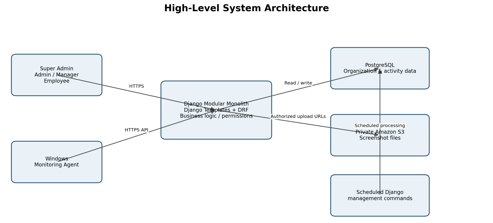
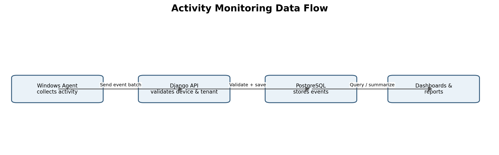
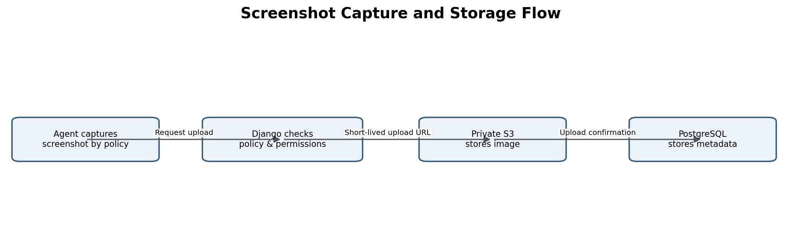

<!-- Converted from Employee_Monitoring_Technical_Architecture...docx with a stdlib docx converter. Formatting is simplified; the .docx remains the original. -->

TECHNICAL ARCHITECTURE DOCUMENT

Employee Monitoring & Workforce Productivity System

Initial SaaS Architecture

| Item | Description |
|---|---|
| Product | Multi-organization employee monitoring and workforce productivity SaaS |
| Architecture | Django Modular Monolith |
| Web UI | Django Templates |
| Backend APIs | Django REST Framework |
| Database | PostgreSQL — shared database with organization-level isolation |
| Screenshot storage | Private Amazon S3 |
| Hosting | AWS EC2 |
| Desktop agent | Windows agent for initial release |

## 1. Purpose and Scope

This document describes the technical architecture for the Employee Monitoring & Workforce Productivity System based on the approved Product Requirements Document (PRD). It covers the application structure, data storage, monitoring flows, access control, deployment, security and operational requirements.

The product supports multiple customer organizations. Each organization manages its own employees, teams, devices, monitoring policies, activity data, screenshots and reports. The initial implementation uses a single Django application with clear internal modules.

### 1.1 Functional scope

- Organization, employee, department, team and device management.

- Role-based access for Super Admin, Admin, Manager and Employee.

- Desktop monitoring for application usage, supported website usage, active/idle time and activity signals.

- Periodic screenshots governed by organization settings, monitoring hours, exclusions and screenshot policies.

- Productive, unproductive and neutral application/website classification.

- Employee workday timeline and employee, team, organization and Super Admin dashboards.

- Attendance and breaks, productivity goals, usage trends, software utilization, CSV exports, audit logs, notifications and integrations according to the PRD priorities.

- Privacy controls and employee transparency.

### 1.2 Excluded capabilities

- Continuous screen recording, webcam monitoring, microphone recording and actual keystroke logging.

- Payroll processing and salary calculation.

- Advanced AI predictions/recommendations, domain blocking and advanced USB/device monitoring.

## 2. High-Level Architecture

Browser users and the Windows agent communicate with the Django application over HTTPS. Django applies authentication, organization isolation and role permissions. PostgreSQL stores structured application data. Screenshot files are stored in a private S3 bucket. Scheduled Django commands handle recurring work that does not need to run during a user request.

### 2.1 Main components

| Component | Responsibility |
|---|---|
| Django Templates | Render dashboards and administration pages for each user role. |
| Django REST Framework | Provide authenticated APIs for the desktop agent and required application operations. |
| Django modules | Implement organization, workforce, monitoring, screenshot, analytics and reporting logic. |
| Windows agent | Collect application/window usage, supported website activity, activity signals and policy-based screenshots. |
| PostgreSQL | Store organizations, users, teams, devices, events, policies, screenshot metadata, summaries and audit records. |
| Amazon S3 | Store screenshot image files privately. |
| Scheduled Django commands | Run recurring summaries, cleanup and scheduled report tasks. |

## 3. Django Application Structure

The modules below are parts of one Django project and one deployable application. They are not independent microservices.

| Module | Responsibilities |
|---|---|
| accounts | User accounts, login and password reset. |
| organizations | Organizations, tenant context and organization settings. |
| access_control | Roles, permissions and access checks. |
| workforce | Employees, departments, teams and manager-team assignments. |
| devices | Device registration and desktop-agent status. |
| monitoring | Application/website events, activity signals and active/idle calculations. |
| screenshots | Capture policies, upload authorization, screenshot metadata and access records. |
| productivity | Usage categories and productive/unproductive/neutral rules. |
| attendance | Attendance and break records. |
| analytics | Employee, team, organization and platform dashboard data. |
| reports | Reports, CSV exports and export status. |
| notifications | In-app and email notifications. |
| audit | Administrative actions and sensitive access history. |
| integrations | External integration configuration and connectors. |

## 4. User Roles and Access

| Role | Access defined by the PRD |
|---|---|
| Super Admin | Manage the platform and multiple organizations; access platform-level organization management and dashboard. |
| Admin | Manage and view information for their own organization. |
| Manager | View and manage information for assigned teams only. |
| Employee | View their own usage, activity, attendance and timeline information. |

All access restrictions must be enforced on the Django backend. Template-level hiding of links or buttons is not an access-control mechanism. Screenshot viewing and downloading must have explicit permission checks and audit records.

## 5. Multi-Organization Data Design

Use a shared PostgreSQL database and shared schema. Every organization-owned record must be associated with the correct organization_id. Examples include employees, teams, devices, activity events, screenshot metadata, attendance records, reports and audit records.

- Resolve the organization from the authenticated user or registered device on the server.

- Do not trust a tenant or organization identifier supplied by the client as authorization.

- Apply organization scoping to every list, detail, create, update, delete, dashboard, export and screenshot operation.

- Managers are additionally restricted to assigned teams; Employees are restricted to their own records.

- Test that users from one organization cannot access another organization's data.

| Core entity | Purpose |
|---|---|
| Organization | Customer company / tenant. |
| User | User login and profile. |
| Role / Permission | User role and allowed actions. |
| Department / Team / UserTeam | Organization structure and team membership. |
| Device / AgentRegistration | Registered employee device and agent status. |
| Application / Website | Tracked applications and websites. |
| UsageRecord / ActivityRecord | Timestamped monitoring events. |
| Screenshot / ScreenshotPolicy | Screenshot metadata, storage reference and capture rules. |
| UsageCategory / ClassificationRule | Productivity classification. |
| AttendanceRecord / BreakRecord | Attendance and break information. |
| UsageSummary | Aggregated dashboard information. |
| ExportJob / Notification / AuditLog | Report exports, notifications and administrative history. |
| Integration / Goal / Subscription | Additional PRD entities for the relevant product capabilities. |

## 6. Monitoring Data Flow

- The Windows agent authenticates as a registered device and collects monitoring events.

- The agent sends event data to a Django REST Framework API over HTTPS.

- Django validates the device, employee, organization, event data and timestamps.

- Validated events are stored in PostgreSQL with the correct organization and employee references.

- Dashboard and report queries read the records and summaries while enforcing role and organization access.

### 6.1 Desktop agent data

- Active application and focused-window information.

- Supported website activity, according to the browser-tracking implementation.

- Activity signals used to calculate active and idle time; actual keystrokes are not recorded.

- Periodic screenshots only when allowed by the configured screenshot policy.

## 7. Screenshot Capture and Storage

- The agent requests permission to upload a screenshot.

- Django checks the organization screenshot setting, monitoring hours, employee/team exclusions and device authorization.

- Django creates screenshot metadata and returns a short-lived, object-specific upload URL.

- The agent uploads the image to the private S3 bucket.

- The backend records upload status and links the S3 object to the screenshot metadata.

- Authorized users access screenshots through permission-checked viewing or download flows. Access is recorded in the audit log.

Screenshot files are stored in S3; PostgreSQL stores metadata and the object reference. Screenshot frequency, retention, blur defaults, exclusions and viewing/download permissions must follow the approved product policy.

## 8. Hosting and Deployment

| Infrastructure component | Purpose |
|---|---|
| AWS EC2 | Host the Django application and web server. |
| PostgreSQL | Store application and monitoring data; use a managed PostgreSQL service where selected for production. |
| Amazon S3 | Private screenshot object storage. |
| HTTPS/TLS | Secure browser and agent communication. |
| Cloud monitoring and logs | Monitor application and server health, errors and resource usage. |
| Backup | Back up PostgreSQL and define recovery/retention for screenshot objects. |

The application is deployed as one Django application. The database and screenshot bucket should not be publicly accessible. Network access must be restricted to the application and authorized administration paths.

## 9. Scheduled Processing and Reports

Recurring work can be executed through Django management commands triggered by the server scheduler. This covers periodic usage summaries, retention cleanup and scheduled report tasks. Normal web requests should remain short.

| Work item | Processing responsibility |
|---|---|
| Usage summaries | Aggregate activity for dashboard display. |
| Scheduled reports | Generate permitted reports and CSV files. |
| Retention cleanup | Apply approved retention and deletion rules. |
| Notifications | Create in-app notifications and dispatch email where configured. |
| Data checks | Identify failed uploads or inconsistent monitoring records. |

Large or long-running jobs must not be allowed to block normal dashboard/API requests. The PRD calls for asynchronous processing for some workloads; if those workloads exceed what scheduled commands can safely handle, a background task queue will be required.

## 10. Dashboards and Reporting

| View | Information |
|---|---|
| Super Admin | Organization management and platform-level overview. |
| Admin | Organization-wide employee, team, device, application/website, activity and screenshot information. |
| Manager | Assigned-team activity, employee timeline, productivity and permitted screenshot information. |
| Employee | Personal usage, active/idle time, productive hours, attendance where enabled and workday timeline. |

- Application and website usage reports.

- Productive, unproductive and neutral usage summaries.

- Active/idle time and employee workday timeline.

- Usage trends, software utilization and license ROI when license-cost data is available.

- Search, filters and CSV export with role and organization restrictions.

## 11. Security and Privacy

- Use HTTPS for all web and agent communication.

- Use secure password hashing and protected password-reset flows.

- Keep database and application secrets out of source code.

- Keep screenshot storage private and use short-lived authorized upload/download links.

- Encrypt stored data and backups using supported platform encryption.

- Enforce role permissions and organization isolation on every protected backend operation.

- Audit screenshot viewing/downloading and sensitive administrative changes.

- Inform employees about monitoring and show the applicable monitoring status/policy.

- Do not record actual keystrokes, webcam or microphone.

- Apply screenshot blur and sensitive exclusions as configured.

## 12. Reliability, Performance and Growth

- Prevent duplicate event ingestion and avoid double-counting overlapping application/website usage.

- Use database indexes for organization, employee, device and event-time filters.

- Use pagination and date-range filters for timelines and reports.

- Use aggregated summaries for dashboard totals.

- Monitor agent connectivity and failed uploads.

- Define backup retention and test database restoration.

- Measure event volume, screenshot frequency and file size before finalizing backend/database capacity.

The PRD expects the product to handle temporary network interruptions and avoid unnecessary monitoring data loss. The agent-to-server synchronization behavior must therefore include retry/recovery handling. The exact local buffering mechanism is an implementation detail to confirm; without it, events generated while offline may be lost.

## 13. Requirements to Finalize

| Area | PRD item requiring a product/implementation value |
|---|---|
| Screenshot policy | Capture frequency, retention period, blur default and sensitive exclusions. |
| Screenshot access | Admin/Manager/Employee viewing and download permissions. |
| Desktop agent | Supported browser(s), website tracking method and agent/browser-extension responsibility. |
| Device management | Whether an employee can register multiple devices. |
| Attendance | Whether attendance and breaks are included in the first release or a later priority. |
| Integrations | Which external providers are required first. |
| Super Admin | Whether platform administrators can view employee-level monitoring data or only manage organizations/platform settings. |
| Operational targets | Data retention, backup schedule, recovery targets and availability expectation. |

## 14. Architecture Summary

The system is organized as a single Django Modular Monolith with Django Templates for the web interface and Django REST Framework for agent/application APIs. PostgreSQL stores structured data with organization-level isolation. Private Amazon S3 stores screenshot files. The Windows desktop agent sends monitoring data to the backend over HTTPS. Scheduled Django commands support recurring processing. Backend permissions, privacy policies, audit records, secure storage and tenant isolation apply throughout the system.

This architecture follows the product capabilities and priorities in the PRD while keeping the application structure straightforward. The final infrastructure sizing and any additional processing components should be based on measured event volume, screenshot load and operational requirements.
